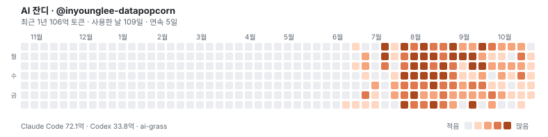

<!-- ai-grass:v2 -->
# AI 잔디

매일 내 컴퓨터의 Claude Code·Codex 토큰 사용량을 날짜별 합계로만 기록합니다. 대화·코드·파일 이름은 올리지 않아요.

<picture>
  <source media="(prefers-color-scheme: dark)" srcset="ai-grass-dark.svg">
  
</picture>

## 내 GitHub 프로필에 붙이기

프로필 README에 아래를 붙여 넣으세요. (이 저장소가 공개 상태여야 보여요)

```html
<picture>
  <source media="(prefers-color-scheme: dark)" srcset="https://raw.githubusercontent.com/inyounglee-datapopcorn/ai-grass/main/ai-grass-dark.svg">
  
</picture>
```

## 실물 3D 스카이라인

GitHub 잔디와 AI 잔디를 합친 3D 조형물 미리보기: https://skyline.datapopcorn.ai/@inyounglee-datapopcorn

---
ai-grass로 매일 자동 기록됩니다. 기록 형식: `usage.json` (기기별 날짜별 합계)
